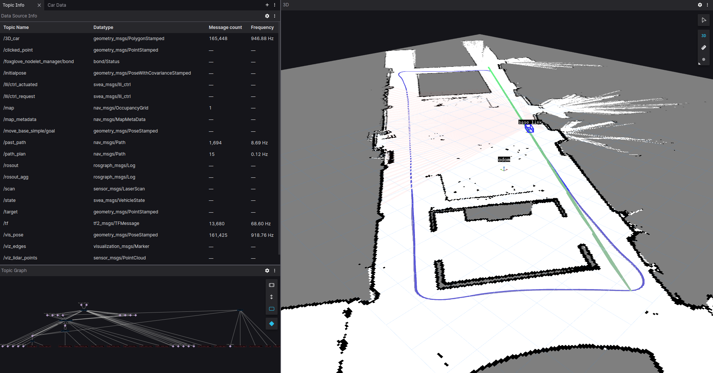

# SVEA Starter Suite

ROS 2 Jazzy workspace for Small Vehicles for Autonomy (SVEA), with Python
interfaces, vehicle simulation and example controllers.

[Documentation](https://kth-sml.github.io/svea/) ·
[Tutorials](https://kth-sml.github.io/svea/tutorials/0_intro/) ·
[SVEA website](https://svea.eecs.kth.se)

## Installation

On macOS, we recommend [OrbStack](https://orbstack.dev/); Docker Desktop also
works. See [Docker setup](docs/setup/docker.md) for other platforms.
Then run on the host:

```bash
git clone https://github.com/KTH-SML/svea.git
cd svea
util/build
util/run
```

See [Docker setup](docs/setup/docker.md) for platform requirements and the
edit/build workflow, or [native installation](docs/development/native_build.md)
for Ubuntu 24.04.

## Run the simulation

Inside the container:

```bash
ros2 launch svea_examples floor2.launch.py
```

This starts two simulated vehicles and a Foxglove bridge. Open
[Foxglove](https://foxglove.dev/download), connect to `ws://localhost:8765`,
and import `foxglove/Floor2 Pure Pursuit.json` from the host checkout.



Continue with the [Floor 2 tutorial](docs/tutorials/1_floor2.md) to modify the
controller.

## Use a vehicle

- [Hardware and assembly](docs/setup/hardware.md): vehicle overview and illustrated assembly manuals.
- [RC operation](docs/setup/rc_operation.md): controls, driving and shutdown.
- [ROS connection](docs/setup/ros_bringup.md): connect the onboard workspace to PX4.
- [MoCap localization](docs/mocap_localization.md): DISCOWER Qualisys setup.

## Related repositories

- [svea_parts](https://github.com/KTH-SML/svea_parts): CAD files, printable parts and assembly manuals.
- [SVEA-PX4-Autopilot documentation](https://github.com/nilskiefer/SVEA-PX4-Autopilot/blob/8e17861fa85809fecdbdddea035b0fa49264517a/docs/en/svea/index.md): firmware setup, flashing, troubleshooting and PMB3 reference.
