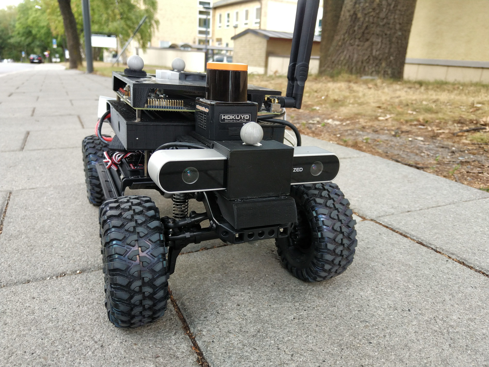

# Hardware and Assembly

*SVEA chassis, front camera, LiDAR and computer platform.*

## Find your way around

- **Chassis:** wheels, steering, motor and gearbox.
- **Platform:** holds the battery, computer and electronics.
- **Power board and controller:** connect the battery, receiver and actuators.
- **Sensors:** LiDAR, cameras and wheel encoders.

## Assembly manuals

The [svea_parts repository](https://github.com/KTH-SML/svea_parts) contains
the CAD files, printable parts and illustrated assembly manuals:

- [Main Platform](https://github.com/KTH-SML/svea_parts/blob/main/SVEA_Main_Platform.pdf): chassis, platform, battery holder, electronics and encoders.
- [Accessories](https://github.com/KTH-SML/svea_parts/blob/main/SVEA_Accessories.pdf): LiDAR, camera and rear mounts.
- [Charging](https://github.com/KTH-SML/svea_parts/blob/main/SVEA_Charging.pdf): charging-arm and box assembly.

Assemble with power disconnected. Before connecting the battery, check its
polarity, secure the battery and make sure cables clear the wheels.
The assembly PDFs show an earlier controller revision.

## PX4 firmware

See the [SVEA-PX4-Autopilot documentation](https://github.com/nilskiefer/SVEA-PX4-Autopilot/blob/8e17861fa85809fecdbdddea035b0fa49264517a/docs/en/svea/index.md)
for firmware setup, flashing, troubleshooting and PMB3 connections.

Next: [start and operate the vehicle with the RC](rc_operation.md).
