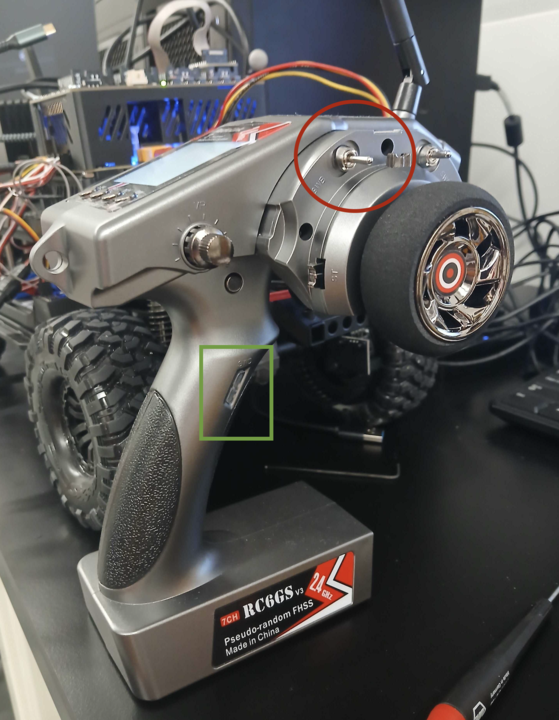
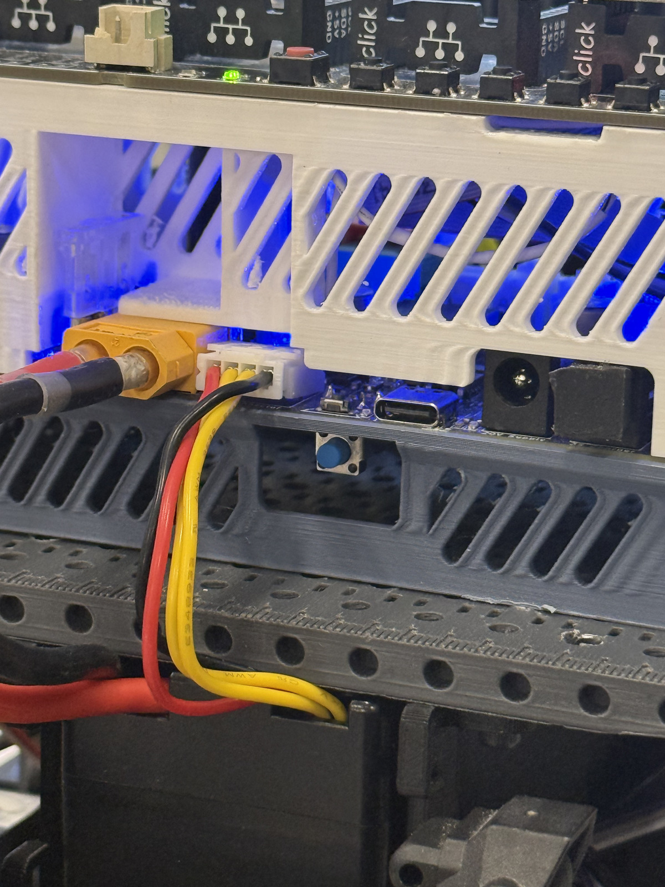
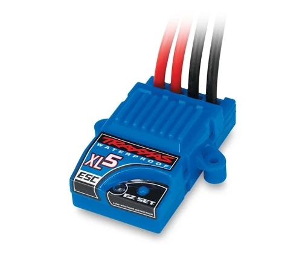

# Starting and Operating with the RC

Use the pictured transmitter to drive the PX4-equipped SVEA.
RC driving works without ROS.

## Controls

{ width="560" }

- **Steering wheel:** steer.
- **Trigger:** throttle; release to neutral.
- **Green-marked button (SWD):** arm (enable driving).
- **Red-circled switch (SWB):** middle = RC driving; right = kill; left = ROS control.

## Start

1. Release the throttle, set the red-circled switch to **kill**, then turn on the RC.
2. Connect the vehicle battery. Press and hold the blue power button until the lights turn on, go off, and turn on again. Then release the button.

    { width="360" }

3. Move the red-circled switch to the **middle** for RC driving.
4. Press the green-marked button to **arm** (enable driving). You may need to press and hold until the servos stay on; this should be audible.
5. **On first bringup, turn on the ESC:** briefly hold its **EZ-Set** button until it lights up, then release.

    { width="360" }

6. Use the trigger to drive and the wheel to steer.

## Stop

Move the red-circled switch to **kill** (right), or turn off the remote.

## Shut down

1. Move the red-circled switch to **kill**.
2. Shut down the onboard computer normally, if running.
3. Turn off vehicle power and disconnect the battery.
4. Turn off the RC last.

Kill does not disconnect the battery. Disconnect power before
handling wiring or the drivetrain.

For setup and troubleshooting, see the [firmware RC guide](https://github.com/nilskiefer/SVEA-PX4-Autopilot/blob/8e17861fa85809fecdbdddea035b0fa49264517a/docs/en/svea/controlling-the-car.md).
